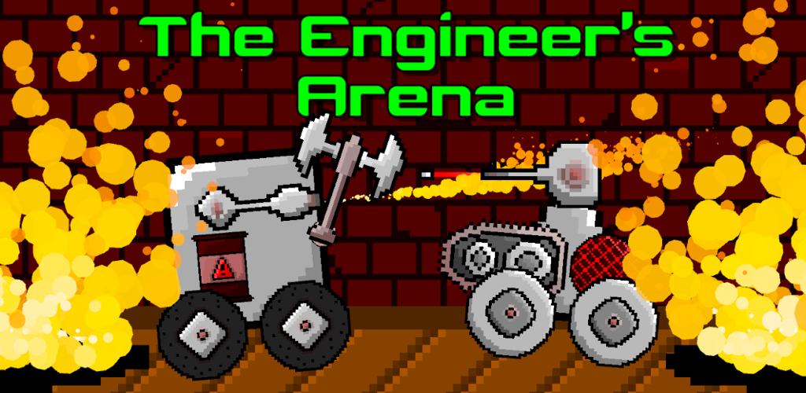
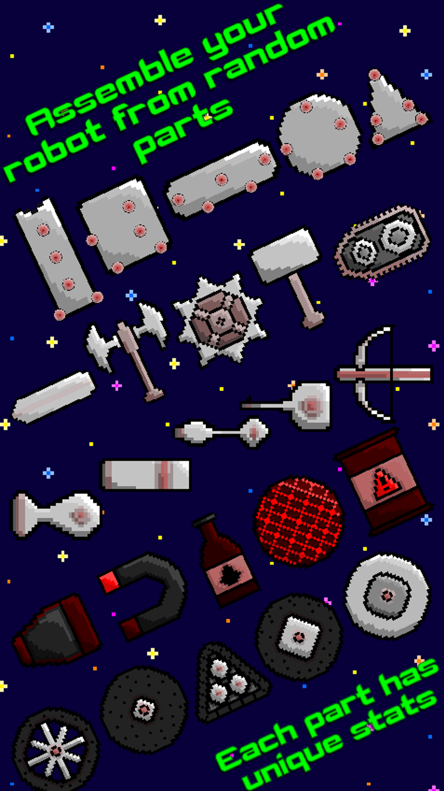
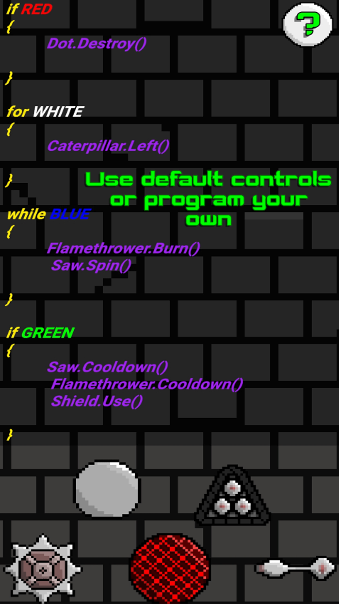
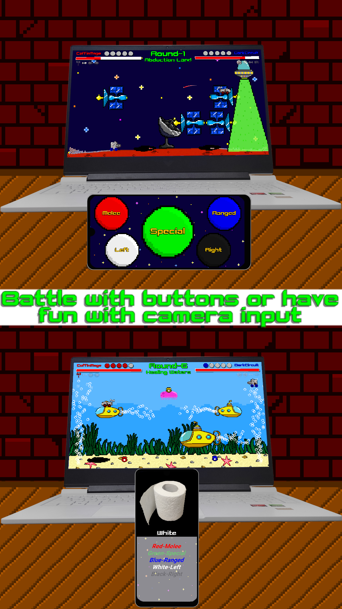
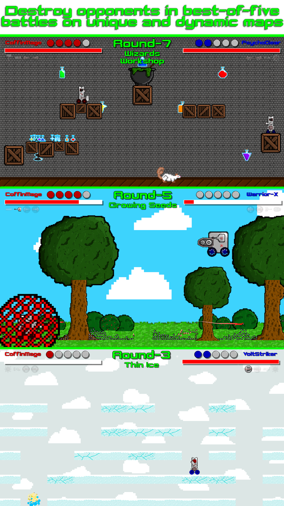
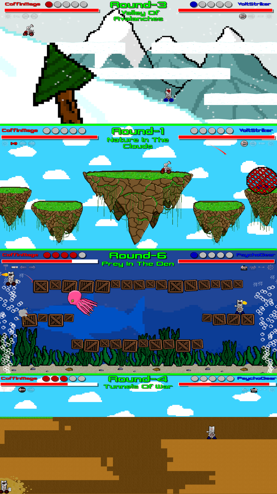
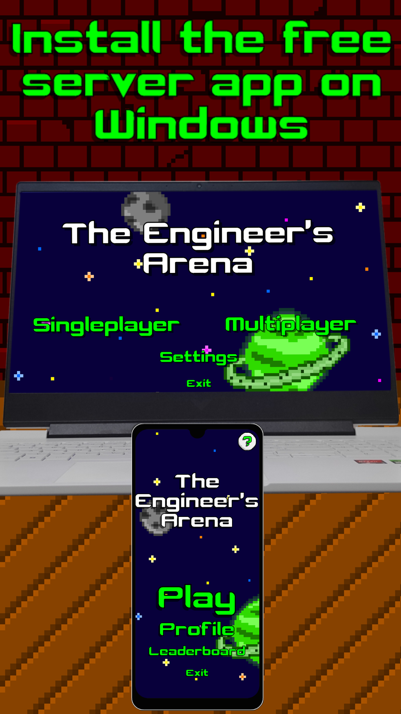
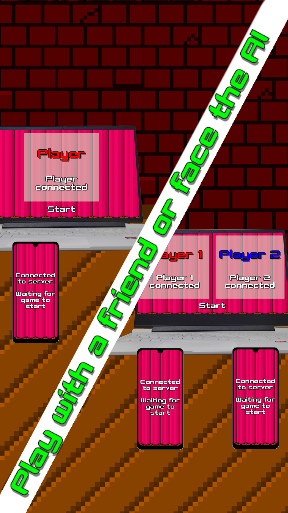
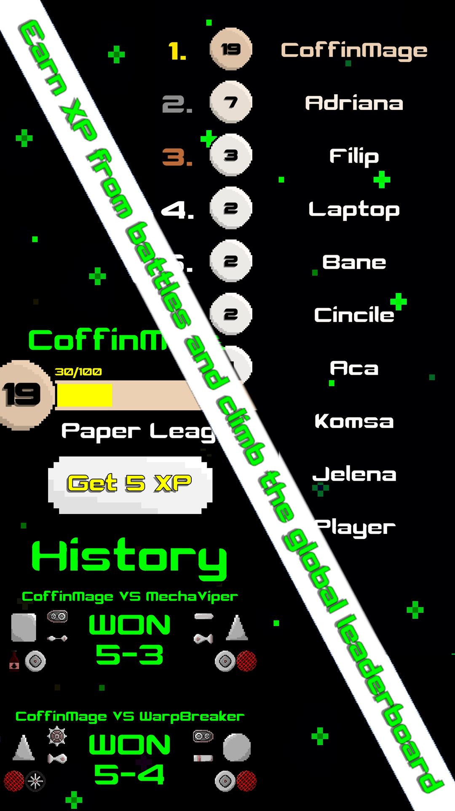

# The Engineer's Arena

  

*A small robot-fighting game that somehow grew out of an experiment with a phone camera.*

**[▶ Watch gameplay & controls](https://youtu.be/LSZG5n5sr74)** · **[▶ Watch all 25 arenas](https://youtu.be/X6AgpNQSR3o)** · **[⬇ Download the game (Windows + Android)](https://github.com/nikolasa004/TheEngineersArena/releases/tag/v1.0.0)**

## So, what is this game?

**The Engineer's Arena** is a 2D robot-fighting game I made in Unity and C#. The actual battles run on a Windows computer, while an Android phone works as the controller. The two communicate over a local network.

You can play against a computer-controlled opponent or against a friend using another phone. Before fighting, you assemble your robot from different parts and weapons. Each part has its own properties, and I did my best to balance the combinations.

The part I find most interesting is the choice of controls. You can use ordinary on-screen buttons, set up your own instructions for how the robot should respond, or use the phone's **camera to recognize colors** and turn the things you show it into inputs. That last option isn't perfect, but trying to make it work was actually the reason this whole project started.

  
  
  

**[See all three control methods in action →](https://youtu.be/LSZG5n5sr74)**

## The 25 arenas

There are **25 maps**, split into five groups of five: medieval castles, forests, underwater environments, winter landscapes, and Mars. Different layouts and hazards change how battles play out.

  
  

**[Watch a video showing every arena →](https://youtu.be/X6AgpNQSR3o)**

## How it started

I started working on this in **January 2025**, during a period when university classes were interrupted. I decided to use the unexpected free time to try a few things that had caught my interest during my studies.

There were really only two ideas at first: **recognizing colors through a phone camera** and **sending information between a phone and a computer**. I wasn't planning a robot game, or even necessarily a game at all. I just wanted to see whether I could get those two things working. Unity and C# were what I was most comfortable with at the time, so that's what I used.

Once I had a working experiment, I figured I might as well turn it into something playable. That's usually what happens when I start learning something new: sooner or later, I start wondering how to make a game out of it.

I like games where you get to build your own things, so I came up with the idea of assembling little fighting robots. I drew the robot parts and put the basic combat together. For the environments, though, I didn't want to spend weeks drawing everything again. I was already working on a bigger game called **Color Attack**, so I reused and adapted its sprites. That's where the five environmental themes came from.

I put the game together in **less than a month**, from early to late January. I also tried integrating ads and a Firebase leaderboard, simply to learn how those worked. The Android version reached testing on Google Play, and I uploaded the Windows game to itch.io. I eventually stopped distributing it there; asking someone to install both a phone app *and* a Windows game is a bit much for a casual download.

And that's basically the story. It started with pointing a phone camera at colors, and somehow ended up with robots fighting across 25 arenas.

## Downloading and playing

Get the files from **[the latest release](https://github.com/nikolasa004/TheEngineersArena/releases/latest)**:

1. Download **`TheEngineersArena.zip`** for Windows, extract the entire folder, and run the game.
2. Install **`TheEngineersArena.apk`** on an Android phone.
3. Connect the phone and computer to the same local network, and start the Windows game before connecting from the phone. Windows Firewall may ask you to allow the game on a private network.
4. Choose **singleplayer** with one phone or **multiplayer** with two phones.

The Android app is a controller for the Windows game, **not a standalone mobile version**. Some guest, school, or public Wi-Fi networks block communication between devices, so a normal private home network is the easiest place to try it.

## A few notes

This was a hobby experiment, not a carefully planned or professionally structured project. I was trying several things for the first time, often figuring them out as I went, and the code definitely shows it in places. The camera controls, in particular, are far from perfect. Still, those separate ideas turned into a complete little game, and I thought it was worth sharing.

The repository contains the **Windows and Android Unity projects** as well as the game's images. Some third-party assets, including **Simple FX Kit**, aren't included in the source repository because they belong to their original creators. You may need to restore external dependencies if you want to open and rebuild everything yourself; the downloadable game builds are provided separately.

I also used the project to experiment with **Google Mobile Ads** and **Firebase**. Those aren't services I'm actively maintaining for this release. The old leaderboard can be viewed, but uploading or changing scores is disabled. Local profile progress, XP, and battle history are separate from that online leaderboard.

### A few more pictures

These are some of the promotional images I originally made for the Google Play version:

  
  
  

Thanks for taking a look!
